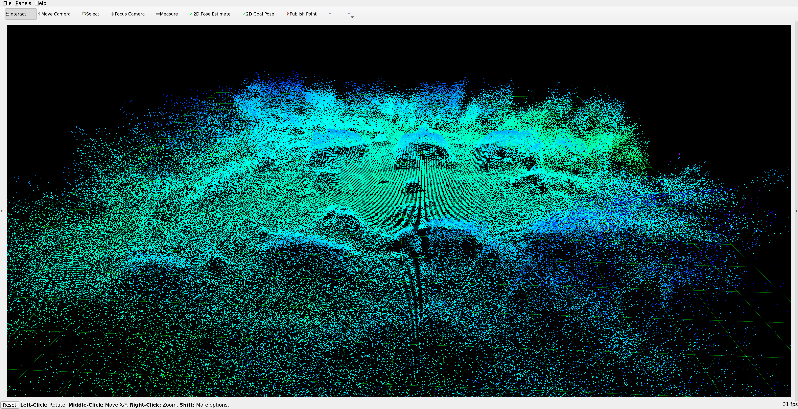
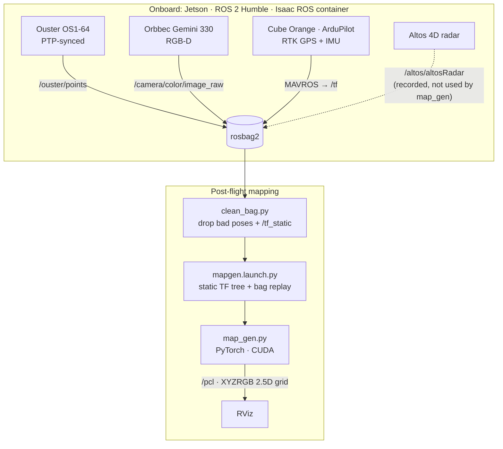
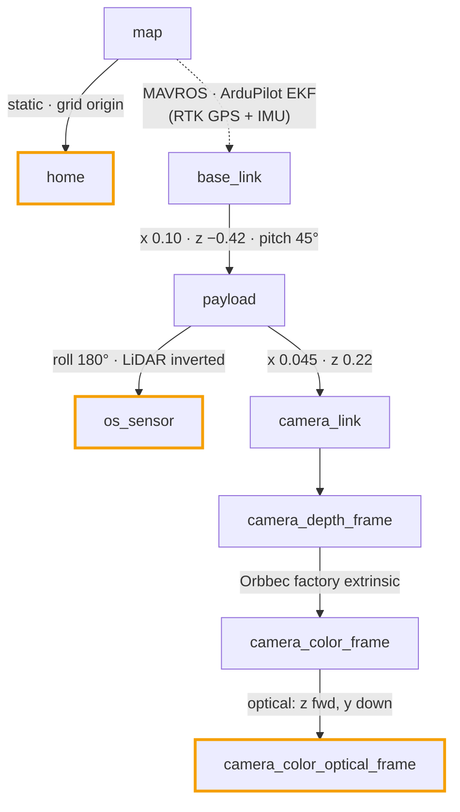
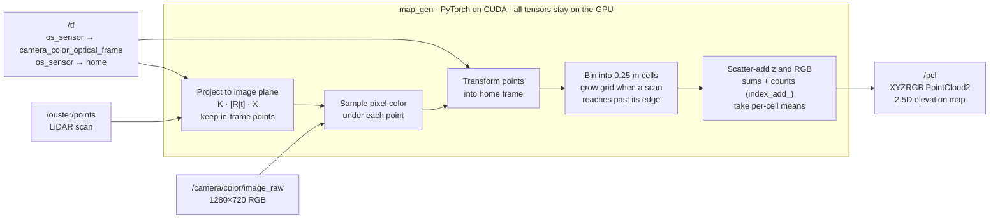

# skyplexus
A ROS2-based UAV high-resolution sensing testbed, with LiDAR, radar, camera, RTK GPS, and Cube Orange running ArduPilot.

A PyTorch node fuses the LiDAR and camera into a colorized 2.5D elevation map on the GPU.

Personal project, built solo during the winter of my senior year of high school (2024–25).


Flight over my house and the surrounding street. Flight data is not included in this repository.



Uncolored version of the map, viewed in RViz.

## Architecture



## TF tree



Solid edges are static transforms from `mapgen.launch.py`; the dashed edge is published by MAVROS. Highlighted frames are the ones `map_gen` looks up: `os_sensor → camera_color_optical_frame` and `os_sensor → home`.

## How map_gen works



`map_gen` is a single ROS 2 node with two subscriptions and one publisher. The camera callback keeps only the most recent `/camera/color/image_raw` frame as a GPU tensor. The LiDAR callback does all the work: for every `/ouster/points` scan it looks up `os_sensor → camera_color_optical_frame` and `os_sensor → home` from TF and moves the scan onto the GPU.

Each scan is projected through the camera intrinsics in a single matrix product, and only the points that land inside the 1280×720 image are kept. The pixel under each surviving point gives its color, and the same points are transformed into the `home` frame, which is the fixed grid origin.

Points are binned into 0.25 m cells by their map-frame x and y. The grid is not pre-sized: whenever a scan reaches outside the current bounds, the sum and count tensors are padded to the new extent with existing cells left in place. Each scan's height and RGB values are scatter-added into their cells with `index_add_` alongside a hit count, so the per-cell means stay cheap to compute. The cell centers, mean heights and packed mean colors are published as an XYZRGB `PointCloud2` on `/pcl` after every scan, which is what RViz displays.

## Code

| Path | Contents |
|---|---|
| [`src/py_perception/py_perception/map_gen.py`](src/py_perception/py_perception/map_gen.py) | Map generator node |
| [`src/radar_drone_launch/launch/apm_altos.launch.py`](src/radar_drone_launch/launch/apm_altos.launch.py) | In-flight bring-up: Ouster, Orbbec, MAVROS, static TFs, `ros2 bag record` |
| [`src/radar_drone_launch/launch/mapgen.launch.py`](src/radar_drone_launch/launch/mapgen.launch.py) | Post-flight: static TF tree, bag replay, `map_gen`, RViz |
| [`src/radar_drone_launch/launch/mavros/`](src/radar_drone_launch/launch/mavros/) | MAVROS launch files, plugin allow-list and TF settings for ArduPilot |
| [`src/radar_drone_launch/config/`](src/radar_drone_launch/config/) | Ouster driver parameters (PTP timestamps, 1024x20 mode, 180° azimuth window), `ptp4l.conf`, RViz config |
| [`tools/clean_bag.py`](tools/clean_bag.py) | Removes `map → base_link` poses beyond 10 km and the recorded `/tf_static` before replay |
| [`Dockerfile`](Dockerfile) | ROS 2 Humble + PyTorch image that builds the workspace |

## Build and run

```bash
docker build -t skyplexus .
docker run --rm -it --gpus all skyplexus bash
source install/setup.bash
```

`map_gen` runs on CUDA, so it needs an NVIDIA GPU.

On the drone, `apm_altos.launch.py` also needs [MAVROS](https://github.com/mavlink/mavros), [ouster-ros](https://github.com/ouster-lidar/ouster-ros) and [OrbbecSDK_ROS2](https://github.com/orbbec/OrbbecSDK_ROS2):

```bash
ros2 launch radar_drone_launch apm_altos.launch.py
```

After the flight, clean the recorded bag (the input and output bag names are set in the script), then replay it through the mapper:

```bash
python3 tools/clean_bag.py
BAG=<cleaned bag> OFFSET=<start offset in seconds> ros2 launch radar_drone_launch mapgen.launch.py
```

## License

[MIT](LICENSE)
